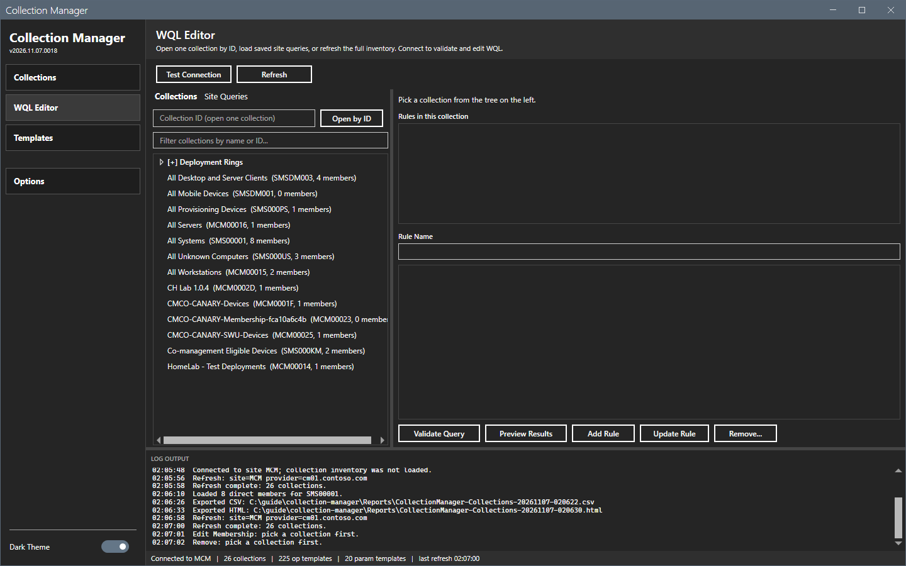
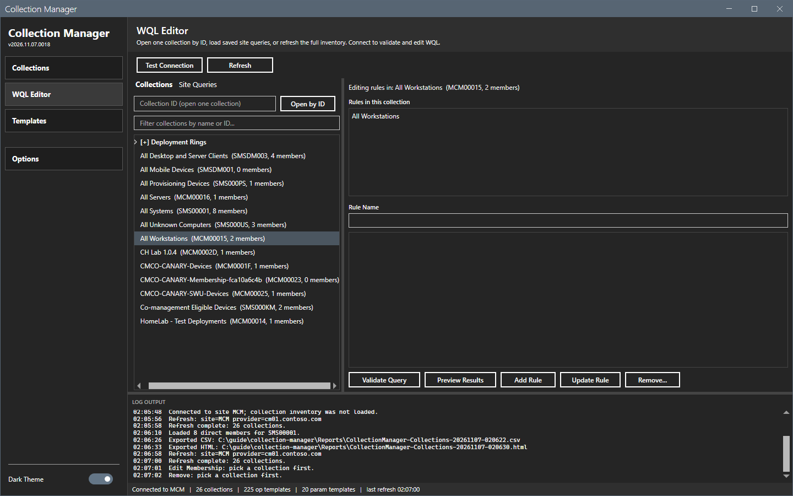
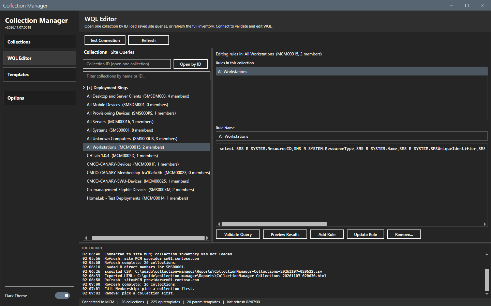
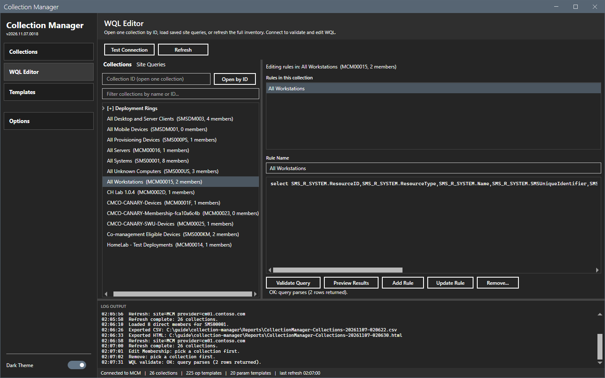
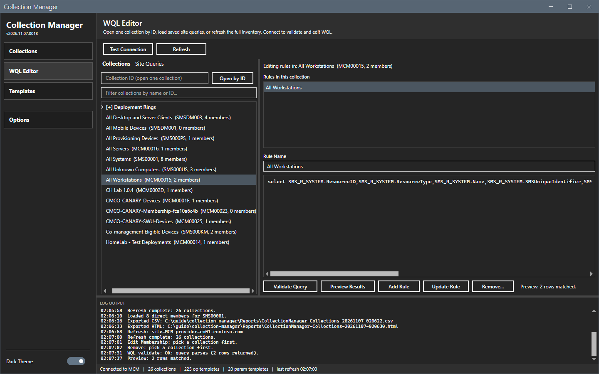
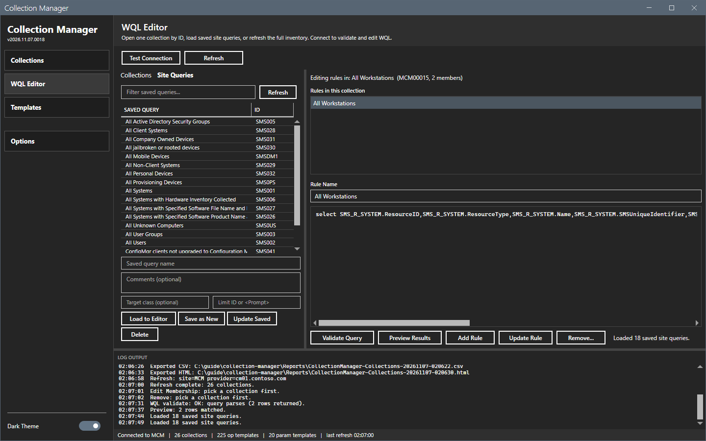
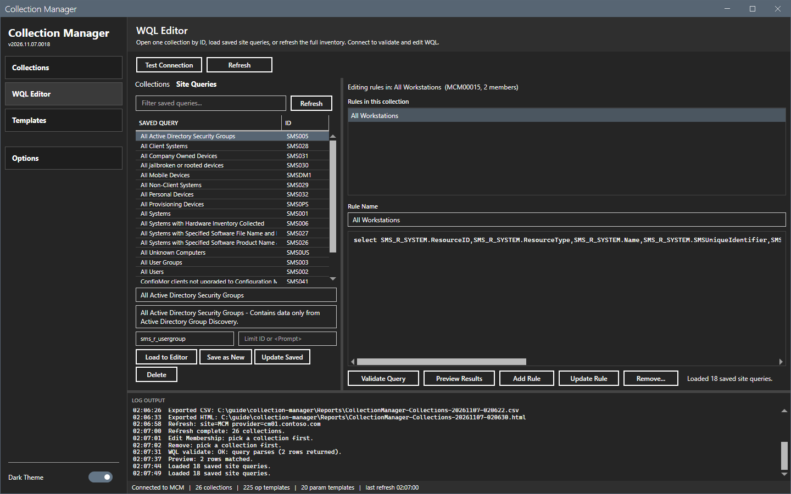

# WQL Editor

The WQL Editor edits the query rules of a collection and manages the saved queries of the site.

## What it does

The **Collections** tab opens a collection by its ID, or from the tree after a full refresh. Select it to see its query rules. The editor holds the WQL of the selected rule. **Validate Query** checks the syntax and **Preview Results** counts the matches. Both read the site and change nothing. **Add Rule**, **Update Rule** and **Remove...** change the collection. The **Site Queries** tab lists the queries that the site saves.

## When to use it

Use it to write a new rule, to test a query before you apply it, to change or remove a rule, and to reuse a query that the site saves.

## Requirements

- **Connect Site** for **Open by ID**. A full **Refresh** on the Collections view for the tree.
- For **Add Rule**, **Update Rule**, **Remove...** and the buttons of the saved queries: the right to change the collection or the saved query.

## Steps

### Pick a rule

1. Select **WQL Editor** in the sidebar.

2. Type a collection ID in the box and select **Open by ID**. Or type text in the tree filter, and select a collection in the tree. The text above the rules shows `Editing rules in: <name> (<ID>, <n> members)`.
3. Select a rule in the list. The rule name and the WQL show in the editor.

### Validate and preview

1. Select **Validate Query**. The tool runs the WQL against the site with `Invoke-CMWmiQuery` and collects the result. A query that costs much can take time and load the SMS Provider. The log shows `WQL validate: OK: query parses (<n> rows returned).`
2. Select **Preview Results**. The text next to the buttons shows `Preview: <n> rows matched.`

### Add, update or remove a rule

1. To add a rule, type a rule name and the WQL and select **Add Rule**. The log is expected to show `Added rule "<name>" to collection <collection name>.`
2. To change a rule, select it, change the name or the WQL and select **Update Rule**. If the site refuses the new rule, the tool adds the old rule back. The error says whether it did.
3. To remove a rule, select it and select **Remove...**, then confirm.

This guide did not add, update or remove a rule. The behavior of these buttons was read from the code only. They were not run.

### Use the saved site queries

1. Connect to the site. Select the **Site Queries** tab. The first time that you select the tab after the connection, the tool loads the saved queries by itself. Before the connection, the list stays empty.

2. Select **Refresh** next to the filter box to read the list again. The list shows the name, the ID, the comment, the target class and the limiting collection ID.

3. Select a query and select **Load to Editor** to edit its WQL.

4. Type a name, a comment, a target class and a limiting collection ID in the fields under the list. **Save as New** saves the editor text as a new query. **Update Saved** changes the selected query. **Delete** removes it from the site.

This guide read the list. It did not use the buttons that save, update or delete a site query.

## Options and settings of this page

| Control | Effect |
|---|---|
| **Open by ID** | Opens one collection by its ID after **Connect Site**. |
| Tree filter | Filters the tree by name or ID. |
| **Validate Query** | Runs the query against the site and reports an error or the row count. |
| **Preview Results** | Counts the matches. |
| **Add Rule**, **Update Rule**, **Remove...** | Change the collection. |
| Site Queries buttons | Read, load, save, update and delete the saved queries of the site. |

## Limits

- The tool validates by running the query on the site. A query that parses can still match nothing.
- **Preview Results** gives a count, not the devices.
- The tree is empty until a full refresh has run.

## Troubleshooting

| Message or symptom | Cause | Fix |
|---|---|---|
| The tree is empty. | No full refresh has run. | Select **Refresh** on the Collections view, or use **Open by ID**. |
| `WQL validate:` shows an error. | The query has a syntax error, or the SMS Provider is not available, or the account has no access. | Read the error. Correct the query only when the error names the query. Otherwise check the connection and the permissions. |
| The text next to the buttons shows `Refresh first to establish a CM connection.` | No connection is open. | Select **Connect Site** or **Refresh** and try again. |
| The text next to the buttons shows `Preview failed:` | The site could not run the query. | Read the text after the colon and the log. |

## Links

- [Templates](templates.md)
- [Collections](collections.md)
