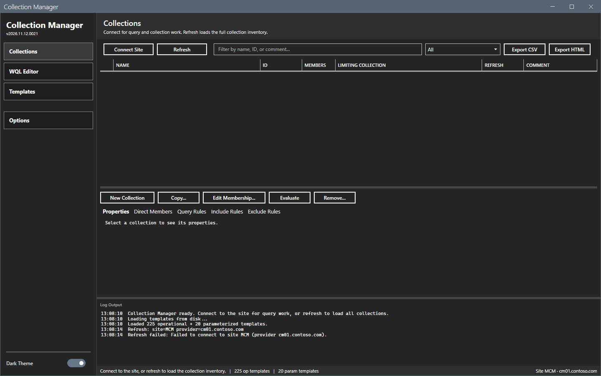

# Error messages

This page lists the messages of Collection Manager with cause and fix. The messages show in the log pane and in the status bar.

## What it does

It maps a message to its cause and to a fix.

## When to use it

Use it when a connection, a refresh or a change does not work.

## Requirements

None.

## Messages

| Message | Where | Cause | Fix |
|---|---|---|---|
| `Open Options to configure site code and SMS provider` | Status bar | The site code or the provider is empty. | Set both in **Options > Connection**. |
| `ConfigurationManager module not found.` | Log | The console is not installed on this computer, or `SMS_ADMIN_UI_PATH` does not point to the `bin\i386` folder of the console. | Install the console. If it is installed, set `SMS_ADMIN_UI_PATH` to its `bin\i386` folder and start the tool again. |
| `Refresh failed:` and `Refresh failed.` | Log, status bar | The tool could not connect or read. | Read the log line for the reason. |
| `Edit Membership: built-in collections are read-only.` | Log | The collection is built-in. | Select a custom collection. |
| `Remove: built-in collection <ID> cannot be deleted.` | Log | The same. | The same. |
| `Add direct member: no device was added for "<name>".` | Log | The name does not match one device, or the lookup failed. | Type the exact device name. |
| `WQL validate:` followed by an error | Log | The query has a syntax error, or the SMS Provider is not available, or the account has no access. | Read the error. Correct the query only when the error names the query. Otherwise check the connection and the permissions. |
| `Refresh first to establish a CM connection.` | Text next to the WQL buttons | No connection is open. | Select **Connect Site** or **Refresh**. |

The image shows **Refresh** on a computer without the console. The window stays open, the grid stays empty and the log names the cause.

## Steps

1. Find the message in the table.
2. Do the fix.
3. Run the action again.

## Limits

- The messages are in English.

## Troubleshooting

See [Troubleshooting](../troubleshooting.md).

## Links

- [Troubleshooting](../troubleshooting.md)
- [Permissions](permissions.md)
